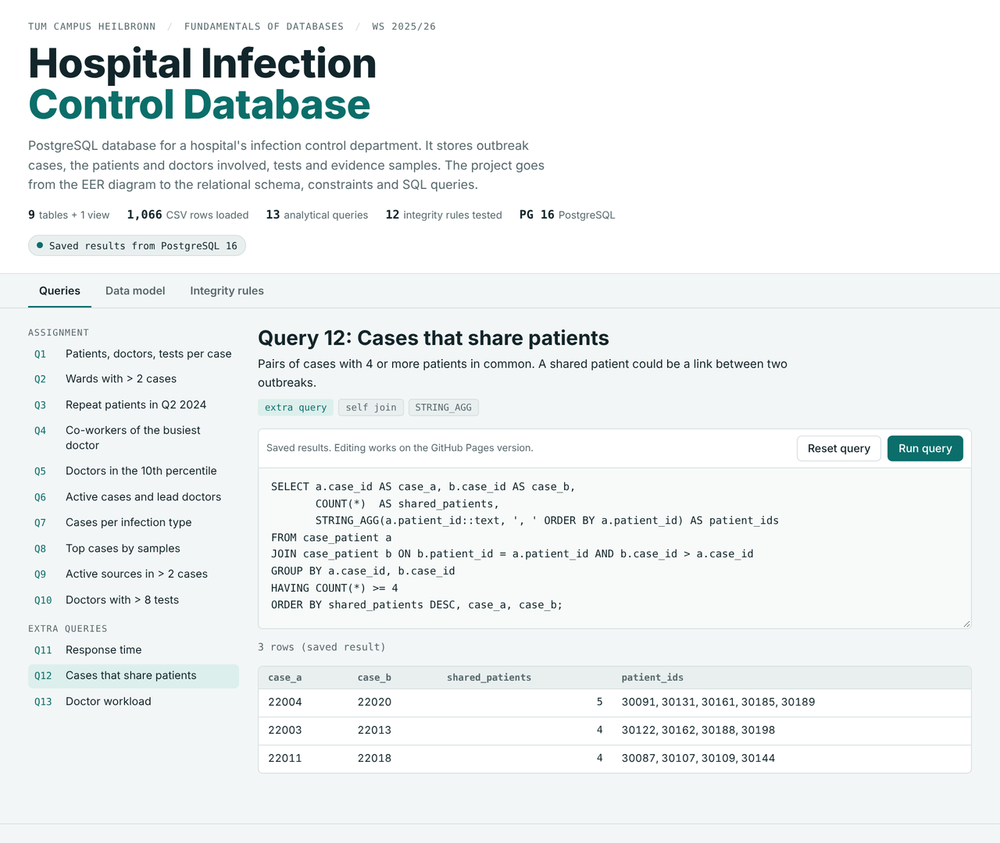

# Hospital Infection Control Database

[](https://github.com/shuyuanwang0502-eng/hospital-infection-control-db/actions/workflows/ci.yml)

PostgreSQL database for the infection control department of a hospital. It keeps track of
outbreak cases, the patients and doctors involved in each case, the tests that were done and the
evidence samples that were collected.

**Demo:** https://shuyuanwang0502-eng.github.io/hospital-infection-control-db/
(runs PostgreSQL in the browser, so you can try the queries without installing anything)

[](https://shuyuanwang0502-eng.github.io/hospital-infection-control-db/)

This started as the bonus project of the course *Fundamentals of Databases* (INHN0011) at TUM
Campus Heilbronn in winter semester 2025/26. The project had three parts:

1. **Conceptual design:** EER diagram from a written description of the requirements
2. **Implementation:** relational schema in PostgreSQL, loading the provided CSV files
3. **Queries:** 10 questions given in natural language, written in SQL

Afterwards I cleaned it up and extended it: fixed two of the queries, added more constraints, a
test script for the constraints, three extra queries, Docker, CI and the demo page. The files as
they were submitted are in [`coursework/`](coursework).

## Data model


Some design decisions:

- `people` is the supertype of `doctors` and `patients` (total and disjoint). Both subtype tables use
  the person id as primary key and foreign key, so other tables can reference a doctor or a
  patient specifically, e.g. the lead doctor of a case has to be in `doctors`.
- `tests` and `evidence_samples` are weak entities. A sample's `storage_id` is only unique inside its
  case, so the key is `(case_id, storage_id)`.
- A test can only be done on a patient who is involved in that case, and the same goes for samples.
  This is enforced with a composite foreign key `(case_id, patient_id)` to `case_patient`, without
  triggers.
- The number of cases per doctor (a derived attribute in the EER diagram) is a view instead of a
  column, so it can't get out of date.

The full explanation of the entities, relationships, the mapping to tables and the constraints that
the relational model can't express is in [docs/design.md](docs/design.md).

## How to run it

With Docker:

```bash
git clone https://github.com/shuyuanwang0502-eng/hospital-infection-control-db.git
cd hospital-infection-control-db
docker compose up
```

This starts PostgreSQL 16, creates the tables, loads the data and runs the tests and all queries.
Afterwards the database is available on `localhost:5432` (user `postgres`, password `postgres`,
database `hospital_infection`).

With an existing PostgreSQL installation:

```bash
bash scripts/run_all.sh hospital_infection
```

The connection is taken from the usual environment variables (`PGHOST`, `PGUSER`, `PGPASSWORD`).

## Queries

Queries 1 to 10 are from the assignment, 11 to 13 are extra ones I added.

| # | Question | SQL features |
|---|---|---|
| 1 | Patients, doctors and tests per case | CTEs, LEFT JOIN |
| 2 | Wards with more than 2 cases | GROUP BY, HAVING |
| 3 | Patients in at least 3 cases in Apr-Jun 2024 who were an active source at least once | COUNT FILTER |
| 4 | Doctors who worked with the doctor with the most cases | CTEs, RANK() |
| 5 | Doctors in the 10th percentile of cases | percentile_disc |
| 6 | Active cases with the name of the lead doctor | JOIN |
| 7 | Cases and active cases per infection type | COUNT FILTER |
| 8 | Top 3 cases by number of samples | FETCH FIRST ... WITH TIES |
| 9 | Patients who are an active source in more than 2 cases | HAVING |
| 10 | Doctors with more than 8 tests and their latest test | COUNT, MAX |
| 11 | Hours from detection to the first test, per ward | window functions |
| 12 | Pairs of cases that share 4 or more patients | self join, STRING_AGG |
| 13 | Tests per doctor and share within the department | DENSE_RANK, SUM() OVER |

The SQL is in [sql/03_queries.sql](sql/03_queries.sql) and the output of every query is in
[docs/query_results.md](docs/query_results.md).

Example, query 12 (cases that might be connected through shared patients):

| case_a | case_b | shared_patients | patient_ids |
|---|---|---|---|
| 22004 | 22020 | 5 | 30091, 30131, 30161, 30185, 30189 |
| 22003 | 22013 | 4 | 30122, 30162, 30188, 30198 |
| 22011 | 22018 | 4 | 30087, 30107, 30109, 30144 |

## Tests

[tests/constraint_tests.sql](tests/constraint_tests.sql) tries 12 inserts, updates and deletes that
break a rule from the requirements (a case without a lead doctor, a test for a patient who isn't in
the case, a work period that ends before it starts, ...) and checks that PostgreSQL rejects each of
them. GitHub Actions runs the whole setup and the tests on every push.

## Files

```
sql/01_schema.sql          tables, constraints, indexes, view
sql/02_load.sql            loads the CSV files through staging tables
sql/03_queries.sql         the 13 queries
tests/constraint_tests.sql constraint tests
data/                      CSV files from the course (synthetic data)
docs/design.md             design explanation
docs/query_results.md      output of all queries
docs/eer_diagram.drawio    EER diagram, can be opened with diagrams.net
docs/index.html            demo page
coursework/                original submission
scripts/                   run_all.sh and the scripts that build the demo page
```

## Ideas for later

- Triggers for the rules the schema can't check yet, e.g. a test has to be after the detection
  of the case and during the patient's stay
- Row level security, so doctors only see the cases they work on
- A bigger generated dataset to compare query plans with and without indexes

The data was provided by the course and is synthetic, there is no real patient data in this repository.
