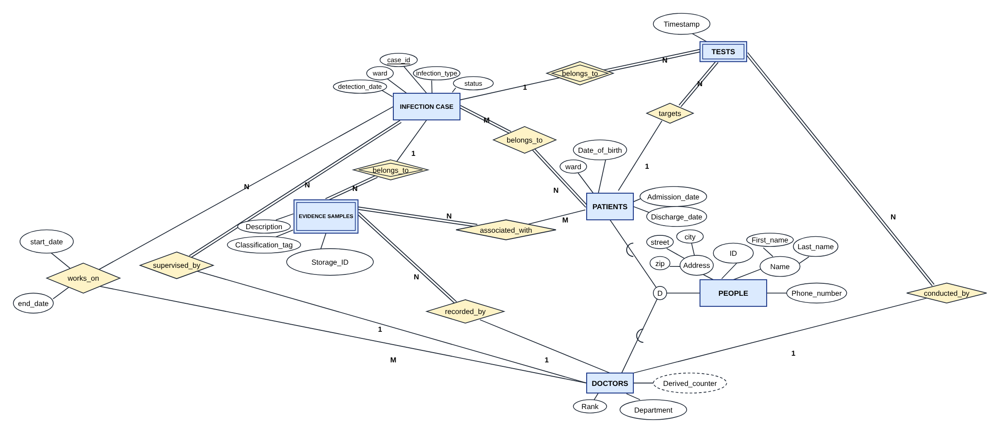
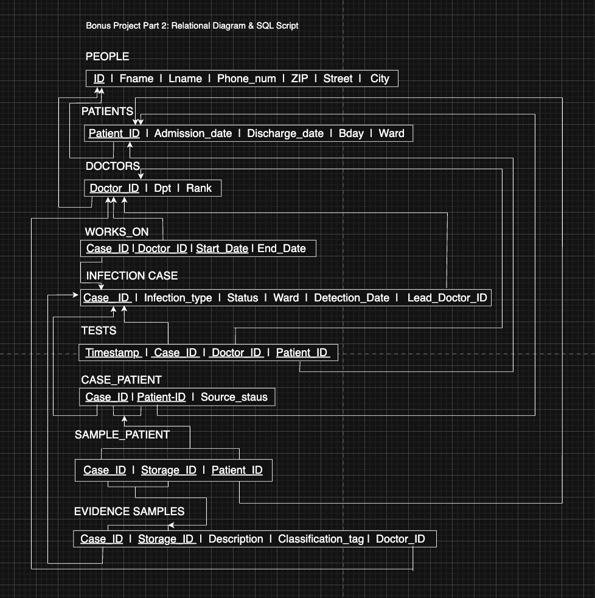

# Design

## Requirements

The task was to design a database for the infection control department of a hospital. The
department investigates infection outbreaks inside the hospital. Summary of the requirements:

- **Infection case:** unique id, infection type (MRSA, COVID-19, ...), date and time of detection,
  status (active or resolved) and ward. A case involves one or more patients, and for each patient
  the department records a `source_status`: is the patient still a possible source of transmission
  (active) or not (cleared). Every case has exactly one lead doctor. Other doctors can also work on
  a case, with a start date and an optional end date.
- **People:** id, first and last name, address (street, city, zip) and phone number. A person is
  either a doctor or a patient.
- **Doctor:** department, rank (Assistant, Senior, Chief) and a derived counter of how many cases
  they investigated.
- **Patient:** date of birth, ward, admission date, optional discharge date. A patient can be in
  several cases over time.
- **Test:** timestamp, belongs to one case, done by one doctor, on one patient who is involved in
  that case.
- **Evidence sample:** belongs to one case, collected by one doctor, has a storage id that is only
  unique within the case, a description and a classification tag (surface swab, blood test, ...).
  A sample can be linked to several patients of the same case.

## EER diagram

The source file is [eer_diagram.drawio](eer_diagram.drawio) (open it with diagrams.net). Double
boxes are weak entities, double diamonds identifying relationships, double lines total
participation, the dashed ellipse is a derived attribute and `D` is the disjoint specialization.

### Entities

**INFECTION CASE** is a strong entity with the key `case_id`. Each case is one outbreak with
`infection_type`, `detection_date`, `ward` and `status`. It doesn't depend on any other entity.

**PEOPLE** is a strong entity for everyone in the system, with the key `ID`. `Name` and `Address`
are composite attributes (first/last name and street/city/zip), which makes them easier to query.
PEOPLE is specialized into PATIENTS and DOCTORS because both share the common attributes but have
different attributes and roles. The specialization is total and disjoint: every person is
either a patient or a doctor.

**TESTS** is a weak entity. A test depends on its infection case and can't exist outside an
investigation.

**EVIDENCE SAMPLES** is a weak entity because `Storage_ID` is only unique within one case. It is a
partial key, and together with `case_id` of the owning case it identifies a sample.

### Relationships

| Relationship | Cardinality and participation | Reason |
|---|---|---|
| belongs_to (case, patients) | M:N, total on the case side | A patient can be in several cases and a case has several patients. Has the attribute `source_status`. |
| supervised_by (case, doctors) | N:1, total on the case side | Each case has exactly one lead doctor, a doctor can lead several cases, and not every doctor leads one. |
| works_on (doctors, case) | M:N, partial, with `start_date` and `end_date` | The other doctors working on a case, besides the lead doctor. |
| belongs_to (samples, case) | N:1, total on the sample side, identifying | Every sample is collected for exactly one case. |
| recorded_by (samples, doctors) | N:1, total on the sample side | One doctor collects a sample, not every doctor collects samples. |
| associated_with (samples, patients) | M:N, partial | A pooled sample can be linked to several patients of the same case. |
| belongs_to (tests, case) | N:1, total on the test side, identifying | A test always belongs to an investigation. |
| conducted_by (tests, doctors) | N:1, total on the test side | Every test has one doctor who did it. |
| targets (tests, patients) | N:1, total on the test side | A test is for one patient, a patient can have several tests in a case. |

## Relational schema

This is the diagram from the submission:

How the EER diagram was mapped to tables:

1. Strong entities become tables: `people`, `infection_case`.
2. The specialization becomes one table per subtype (`patients`, `doctors`). Their primary key is
   also a foreign key to `people(id)`. I chose this over one big table so there are fewer NULL
   columns, and so that other tables can reference a doctor or a patient specifically.
3. Weak entities get the key of the owner as part of their primary key: `evidence_samples` has the
   key `(case_id, storage_id)`, `tests` has `(timestamp, case_id, doctor_id, patient_id)`.
4. N:1 relationships become a foreign key on the N side: `infection_case.lead_doctor_id` (NOT NULL,
   because there is exactly one lead doctor), `evidence_samples.doctor_id`, `tests.doctor_id` and
   `tests.patient_id`.
5. M:N relationships become their own tables with the relationship attributes: `works_on`,
   `case_patient` and `sample_patient`. `start_date` is part of the key of `works_on`, because a
   doctor can work on the same case in two different periods.
6. The derived attribute `case_counter` is the view `doctor_case_counter`.

### Constraints in the schema

| Rule | How |
|---|---|
| Every case has exactly one lead doctor | `lead_doctor_id INT NOT NULL REFERENCES doctors` |
| A test can only be for a patient of the same case | composite FK `tests(case_id, patient_id)` to `case_patient` |
| A sample can only be linked to patients of the same case | composite FK `sample_patient(case_id, patient_id)` to `case_patient` |
| Storage id is unique within a case | primary key `(case_id, storage_id)` |
| Allowed values for status, source_status and rank | `CHECK` constraints |
| A work period or hospital stay can't end before it starts | `CHECK (end_date IS NULL OR end_date >= start_date)`, same for discharge |
| A doctor who still leads a case or did tests can't be deleted | `ON DELETE RESTRICT` |

All of these are tested in [tests/constraint_tests.sql](../tests/constraint_tests.sql).

### Constraints the relational model can't express

- **Total participation**, e.g. every case needs at least one patient. A foreign key only checks
  that the referenced row exists, not that there is a row referencing it. This would need
  triggers (it was not required in the assignment).
- **Total and disjoint specialization.** Nothing stops a person from being in both `doctors` and
  `patients`, or in neither. The load script decides from the `role` column and checks afterwards
  that every person is in exactly one of the two tables.
- **Lead doctor and works_on.** It isn't defined whether the lead doctor should also be in
  `works_on`. In the given data the lead doctors never are.
- **Dates across tables**, e.g. a test should be after the case was detected and while the patient
  is in the hospital. Also only possible with triggers.

## Changes compared to the submission

The submitted files are in [coursework/](../coursework). In `sql/` I changed the following:

- **Detection time:** the submission stored only the date (`detection_date DATE`). The requirement
  says date and time, so it is now `detection_time TIMESTAMP`. Query 11 needs the time.
- **More CHECK constraints:** for `status` and `rank`, before only `source_status` had one.
- **Derived attribute:** `case_counter` was in the EER diagram but not in the schema. Now it is a view.
- **Loading:** the CSV files used to be imported with the IDE. Now `02_load.sql` loads them with
  `\copy`, so everything can be run from the command line or in CI.
- **Indexes** on the foreign key columns used in joins.
- **Query 1:** the old version joined all three tables and counted tests with
  `COUNT(DISTINCT timestamp)`. That would count two tests at the same time as one, and the join
  creates patients x doctors x tests rows. Now every table is counted on its own first.
- **Query 4:** the old version used `LIMIT 1` to find the doctor with the most cases. But two doctors
  both have 5 cases, so one of them was ignored. Now it uses `RANK()`.
- **Query 7 and 8:** `COUNT(*) FILTER` instead of a correlated subquery, and `FETCH FIRST 3 ROWS WITH
  TIES` instead of `LIMIT 3`, so a case tied with third place isn't cut off randomly.
- **Tests:** the constraint tests and the GitHub Actions workflow are new.
